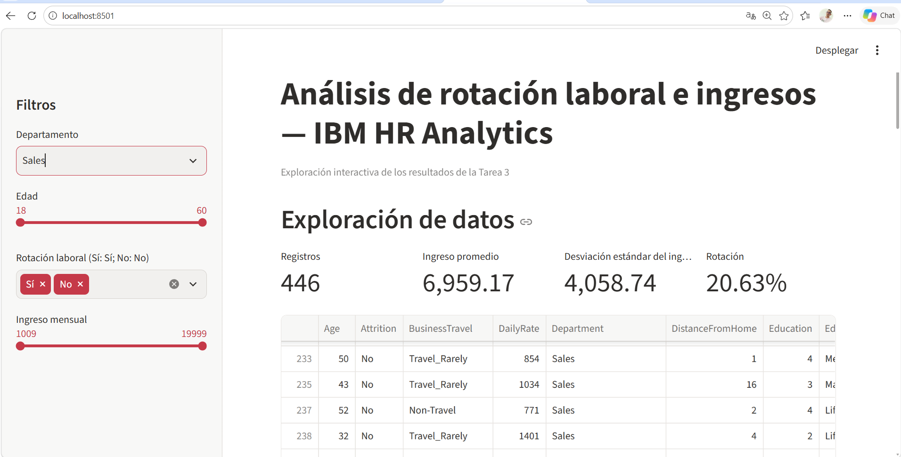
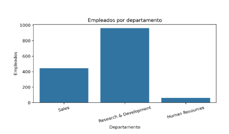
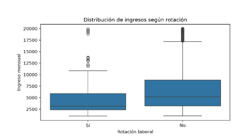
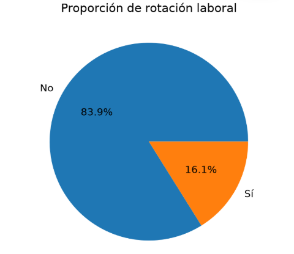
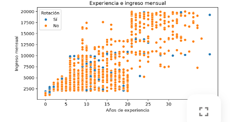
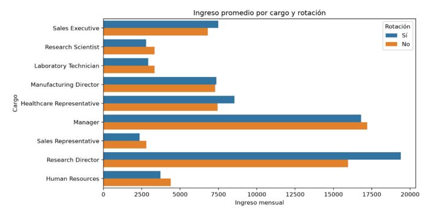
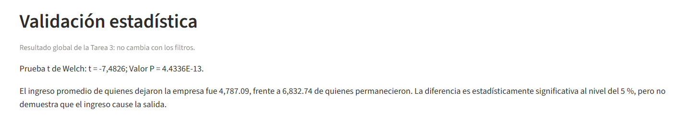
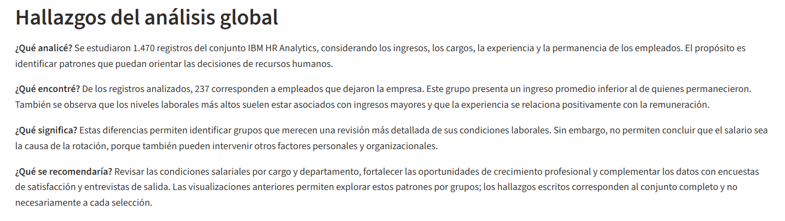
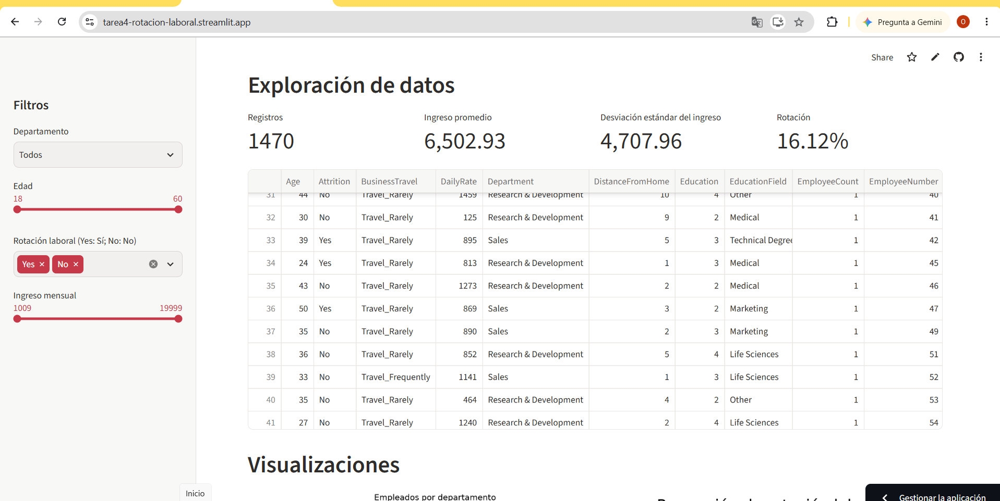

# Dashboard de rotación laboral — IBM HR Analytics

## Descripción del proyecto

Proyecto de la Tarea 4 de Programación para el análisis de datos de la Universidad Nacional Abierta y a Distancia (UNAD).

Presenta los resultados del análisis exploratorio de la Tarea 3 mediante filtros, indicadores estadísticos y gráficos interactivos.

El dataset IBM HR Analytics contiene 1.470 registros y 35 variables. Se conserva el archivo original para estudiar los ingresos, la experiencia y la rotación laboral.

## Dashboard publicado

La aplicación se encuentra disponible en Streamlit Community Cloud:

[Acceder al dashboard interactivo](https://tarea4-rotacion-laboral.streamlit.app/)

## Herramientas utilizadas

- Python
- Streamlit
- Pandas
- Matplotlib
- Seaborn
- SciPy
- GitHub
- Visual Studio Code

## Funcionalidades

- Filtros por departamento, edad, ingreso mensual y rotación laboral.
- Actualización automática de indicadores estadísticos.
- Tabla interactiva de datos.
- Cinco visualizaciones estadísticas.
- Validación estadística mediante la prueba t de Welch.
- Hallazgos y recomendaciones.

## Resultados generales

| Indicador | Resultado |
|---|---:|
| Total de empleados | 1.470 |
| Empleados con rotación | 237 |
| Empleados sin rotación | 1.233 |
| Ingreso mensual promedio | 6.502,93 |
| Desviación estándar | 4.707,96 |
| Rotación laboral | 16,12 % |

## Hallazgos

- 237 empleados presentan rotación laboral.
- El ingreso promedio es menor en el grupo con rotación.
- El nivel laboral y la experiencia se relacionan positivamente con el ingreso.
- El departamento de ventas presenta una rotación del 20,63 %.
- Las asociaciones identificadas no demuestran causalidad.

## Evidencias del funcionamiento

### 1. Dashboard principal

### 2. Funcionamiento de filtros interactivos

### 3. Empleados por departamento

### 4. Distribución de ingresos según rotación

### 5. Proporción de rotación laboral

### 6. Relación entre experiencia e ingreso mensual

### 7. Ingreso promedio por cargo y rotación

### 8. Validación estadística

### 9. Hallazgos y recomendaciones

### 10. Dashboard publicado en Streamlit Community Cloud

## Ejecución local

1. Instalar Python.
2. Descargar los archivos del repositorio.
3. Abrir la terminal en la carpeta del proyecto.
4. Instalar las dependencias:

   `python -m pip install -r requirements.txt`

5. Ejecutar la aplicación:

   `python -m streamlit run app.py`

6. Acceder a http://localhost:8501.

## Información académica

- **Estudiante:** Oscar David Salcedo Ruiz.
- **Grupo:** 08.
- **Universidad:** Universidad Nacional Abierta y a Distancia (UNAD).
- **Curso:** Programación para el análisis de datos.
- **Código:** 203008069.
- **Actividad:** Tarea 4 – Comunicación de resultados mediante dashboard interactivo.
- **Fecha:** Noviembre de 2026.

